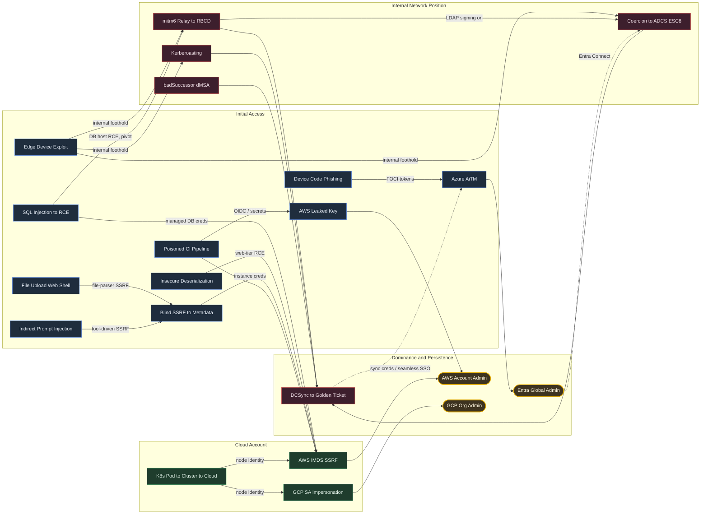

---
tags:
  - hack-notes
  - moc
  - playbook
  - attack-graph
---

# Attack Graph (Playbook Map)

> How the playbooks chain. The end state of one chain is the starting position of the next. This map shows the handoffs: where a foothold becomes privilege, where on-prem crosses into cloud, and where many routes funnel into the same objective. Read the diagram for the shape, then use the edge list below to jump into any chain.

## The Graph

Solid arrows are direct handoffs. Dashed arrows are the on-prem to cloud (and back) bridges that turn a single-domain compromise into a full-estate one.

---

## Entry Points

Where a chain starts, by the access you already have.

| You have | Start here | Lands you at |
|---|---|---|
| An exposed edge appliance (VPN/gateway) | [Edge Device Exploit to Internal Foothold](Edge%20Device%20Exploit%20to%20Internal%20Foothold.md) | Internal network foothold |
| A user willing to click | [Device Code Phishing to M365 Takeover](Device%20Code%20Phishing%20to%20M365%20Takeover.md), [Azure AiTM Token Theft to Global Admin](Azure%20AiTM%20Token%20Theft%20to%20Global%20Admin.md) | Entra cloud identity |
| A web app you can reach | [SQL Injection to RCE to Pivot](SQL%20Injection%20to%20RCE%20to%20Pivot.md), [File Upload to Web Shell to Foothold](File%20Upload%20to%20Web%20Shell%20to%20Foothold.md), [Insecure Deserialization to RCE](Insecure%20Deserialization%20to%20RCE.md), [Blind SSRF to Cloud Metadata RCE](Blind%20SSRF%20to%20Cloud%20Metadata%20RCE.md) | Web-tier RCE or cloud creds |
| A leaked credential | [AWS Leaked Key to IAM Privilege Escalation](AWS%20Leaked%20Key%20to%20IAM%20Privilege%20Escalation.md) | Cloud account |
| Commit access to a repo | [Poisoned CI Pipeline to Cloud Admin](Poisoned%20CI%20Pipeline%20to%20Cloud%20Admin.md) | Cloud account |
| A pod / container shell | [Kubernetes Pod to Cluster to Cloud](Kubernetes%20Pod%20to%20Cluster%20to%20Cloud.md) | Cloud account |
| An LLM agent you can feed content | [Indirect Prompt Injection to Data Exfiltration](Indirect%20Prompt%20Injection%20to%20Data%20Exfiltration.md) | Data exfil or tool-driven SSRF |
| A network position, no creds | [IPv6 mitm6 Relay to RBCD Takeover](IPv6%20mitm6%20Relay%20to%20RBCD%20Takeover.md), [Coercion to ADCS ESC8 to Domain Admin](Coercion%20to%20ADCS%20ESC8%20to%20Domain%20Admin.md) | Domain Admin |
| One low-priv domain credential | [Kerberoasting to Domain Admin](Kerberoasting%20to%20Domain%20Admin.md), [badSuccessor dMSA to Domain Admin](badSuccessor%20dMSA%20to%20Domain%20Admin.md) | Domain Admin |

---

## Convergence Hubs

The objectives that the most chains funnel into. These are the highest-value choke points to both attack and defend.

### Hub 1: AWS IAM privilege escalation
Feeders: [Blind SSRF to Cloud Metadata RCE](Blind%20SSRF%20to%20Cloud%20Metadata%20RCE.md), [AWS IMDS SSRF to Account Takeover](AWS%20IMDS%20SSRF%20to%20Account%20Takeover.md), [AWS Leaked Key to IAM Privilege Escalation](AWS%20Leaked%20Key%20to%20IAM%20Privilege%20Escalation.md), [Poisoned CI Pipeline to Cloud Admin](Poisoned%20CI%20Pipeline%20to%20Cloud%20Admin.md), [Kubernetes Pod to Cluster to Cloud](Kubernetes%20Pod%20to%20Cluster%20to%20Cloud.md). Five distinct entry classes all reach the same place: a set of STS credentials and a hunt for a privesc primitive to account admin.

### Hub 2: Domain Admin to DCSync
Feeders: [Coercion to ADCS ESC8 to Domain Admin](Coercion%20to%20ADCS%20ESC8%20to%20Domain%20Admin.md), [IPv6 mitm6 Relay to RBCD Takeover](IPv6%20mitm6%20Relay%20to%20RBCD%20Takeover.md), [Kerberoasting to Domain Admin](Kerberoasting%20to%20Domain%20Admin.md), [badSuccessor dMSA to Domain Admin](badSuccessor%20dMSA%20to%20Domain%20Admin.md). Every AD route ends by extracting krbtgt and forging durable tickets in [DCSync to Golden Ticket Persistence](DCSync%20to%20Golden%20Ticket%20Persistence.md).

### Hub 3: Entra cloud identity
Feeder: [Device Code Phishing to M365 Takeover](Device%20Code%20Phishing%20to%20M365%20Takeover.md) yields tokens, then [Azure AiTM Token Theft to Global Admin](Azure%20AiTM%20Token%20Theft%20to%20Global%20Admin.md) escalates them to Global Admin. Both phishing routes deliver the same primitive (a valid token without a password).

---

## Chain Handoffs

The edge list, navigable. Each line is "from chain, condition, to chain."

### Initial access to foothold
- [Edge Device Exploit to Internal Foothold](Edge%20Device%20Exploit%20to%20Internal%20Foothold.md) to internal network, then hand to [Kerberoasting to Domain Admin](Kerberoasting%20to%20Domain%20Admin.md), [IPv6 mitm6 Relay to RBCD Takeover](IPv6%20mitm6%20Relay%20to%20RBCD%20Takeover.md), or [Coercion to ADCS ESC8 to Domain Admin](Coercion%20to%20ADCS%20ESC8%20to%20Domain%20Admin.md).
- [SQL Injection to RCE to Pivot](SQL%20Injection%20to%20RCE%20to%20Pivot.md) to a shell on the DB host, then internal pivot into the AD chains. If the database is managed (RDS / Cloud SQL) so OS RCE is blocked, pivot to cloud creds and enter [AWS IMDS SSRF to Account Takeover](AWS%20IMDS%20SSRF%20to%20Account%20Takeover.md).
- [File Upload to Web Shell to Foothold](File%20Upload%20to%20Web%20Shell%20to%20Foothold.md) to a web shell. A malicious SVG/PDF/OOXML upload can also trigger [Blind SSRF to Cloud Metadata RCE](Blind%20SSRF%20to%20Cloud%20Metadata%20RCE.md) through the server-side parser.
- [Insecure Deserialization to RCE](Insecure%20Deserialization%20to%20RCE.md) to web-tier code execution, then the same cloud-metadata or internal-pivot forks as any web RCE.
- [Indirect Prompt Injection to Data Exfiltration](Indirect%20Prompt%20Injection%20to%20Data%20Exfiltration.md) to a hijacked agent. If the agent has a fetch/URL tool, drive it into [Blind SSRF to Cloud Metadata RCE](Blind%20SSRF%20to%20Cloud%20Metadata%20RCE.md).

### Internal to Domain Admin
- [IPv6 mitm6 Relay to RBCD Takeover](IPv6%20mitm6%20Relay%20to%20RBCD%20Takeover.md) to Domain Admin. If LDAP signing and channel binding are enforced (the relay to LDAP fails), branch to [Coercion to ADCS ESC8 to Domain Admin](Coercion%20to%20ADCS%20ESC8%20to%20Domain%20Admin.md) instead.
- [Coercion to ADCS ESC8 to Domain Admin](Coercion%20to%20ADCS%20ESC8%20to%20Domain%20Admin.md), [Kerberoasting to Domain Admin](Kerberoasting%20to%20Domain%20Admin.md), and [badSuccessor dMSA to Domain Admin](badSuccessor%20dMSA%20to%20Domain%20Admin.md) each reach Domain Admin by a different primitive (relay-to-cert, offline crack plus ACL path, dMSA successor abuse).
- All Domain Admin roads continue into [DCSync to Golden Ticket Persistence](DCSync%20to%20Golden%20Ticket%20Persistence.md) for krbtgt extraction and durable persistence.

### Cloud account to admin
- [Blind SSRF to Cloud Metadata RCE](Blind%20SSRF%20to%20Cloud%20Metadata%20RCE.md) yields instance-role credentials, feeding [AWS IMDS SSRF to Account Takeover](AWS%20IMDS%20SSRF%20to%20Account%20Takeover.md).
- [AWS IMDS SSRF to Account Takeover](AWS%20IMDS%20SSRF%20to%20Account%20Takeover.md) and [AWS Leaked Key to IAM Privilege Escalation](AWS%20Leaked%20Key%20to%20IAM%20Privilege%20Escalation.md) converge on the same IAM-privesc hunt to AWS account admin.
- [Poisoned CI Pipeline to Cloud Admin](Poisoned%20CI%20Pipeline%20to%20Cloud%20Admin.md) exfiltrates the runner OIDC token / secrets, then exchanges them like a leaked key ([AWS Leaked Key to IAM Privilege Escalation](AWS%20Leaked%20Key%20to%20IAM%20Privilege%20Escalation.md)) or hits IMDS directly.
- [Kubernetes Pod to Cluster to Cloud](Kubernetes%20Pod%20to%20Cluster%20to%20Cloud.md) steals the node's cloud identity, feeding [AWS IMDS SSRF to Account Takeover](AWS%20IMDS%20SSRF%20to%20Account%20Takeover.md) or [GCP Service Account Impersonation to Org Admin](GCP%20Service%20Account%20Impersonation%20to%20Org%20Admin.md).
- [GCP Service Account Impersonation to Org Admin](GCP%20Service%20Account%20Impersonation%20to%20Org%20Admin.md) walks an impersonation chain to GCP org admin.

### Phishing to cloud identity
- [Device Code Phishing to M365 Takeover](Device%20Code%20Phishing%20to%20M365%20Takeover.md) captures tokens, which [Azure AiTM Token Theft to Global Admin](Azure%20AiTM%20Token%20Theft%20to%20Global%20Admin.md) escalates (SP credential abuse, PIM, dynamic-group injection) to Global Admin.

### On-prem and cloud bridges
- [Azure AiTM Token Theft to Global Admin](Azure%20AiTM%20Token%20Theft%20to%20Global%20Admin.md) at Global Admin pivots on-prem through Entra Connect / cloud sync into the AD chains ([Coercion to ADCS ESC8 to Domain Admin](Coercion%20to%20ADCS%20ESC8%20to%20Domain%20Admin.md), [Kerberoasting to Domain Admin](Kerberoasting%20to%20Domain%20Admin.md)).
- [DCSync to Golden Ticket Persistence](DCSync%20to%20Golden%20Ticket%20Persistence.md) (Domain Admin) pivots the other way: the Entra Connect sync account, seamless-SSO AZUREADSSOACC key, or a synced privileged identity reopens the cloud through [Azure AiTM Token Theft to Global Admin](Azure%20AiTM%20Token%20Theft%20to%20Global%20Admin.md).

---

## End States

The objectives the graph terminates in:

- AWS account administrator (Hub 1).
- GCP organization administrator.
- Entra Global Administrator (Hub 3), and through it the M365 data estate.
- Domain Admin with golden-ticket persistence (Hub 2).
- Bulk data exfiltration (the AI and several web chains).

A full-estate compromise usually means crossing a bridge: reaching one of these, then using it to enter another domain (AD to cloud, or cloud to AD).

---

## How to Use This Map

- Planning an engagement: pick your real starting access from Entry Points, walk the arrows, and pre-stage the next chain before you need it.
- Triaging a finding: trace it forward. A single web SSRF is a hub feeder, not a dead end. Report it as the start of a path to AWS account admin, not as an isolated bug.
- Defending: the convergence hubs are where one control breaks many chains. Enforce IMDSv2 and least-privilege IAM (Hub 1), tier-0 isolation and ADCS hardening (Hub 2), phishing-resistant MFA and token-binding (Hub 3).
- Use Ariadne to render the same kind of graph automatically from real engagement findings, and Vinculum to correlate the findings that feed it.

---

## Related

- Hack Notes: the full vault index (cheatsheets, checklists, playbooks)
- [Internal Network and Active Directory](../Checklists/Internal%20Network%20and%20Active%20Directory.md), [AWS Cloud Penetration Test](../Checklists/AWS%20Cloud%20Penetration%20Test.md), [Azure and M365 Entra ID](../Checklists/Azure%20and%20M365%20Entra%20ID.md), [Red Team Operation](../Checklists/Red%20Team%20Operation.md): the checklists behind these chains
- Ariadne: attack-path graph and MITRE mapping from findings
- Vinculum: correlate and deduplicate findings across tools
